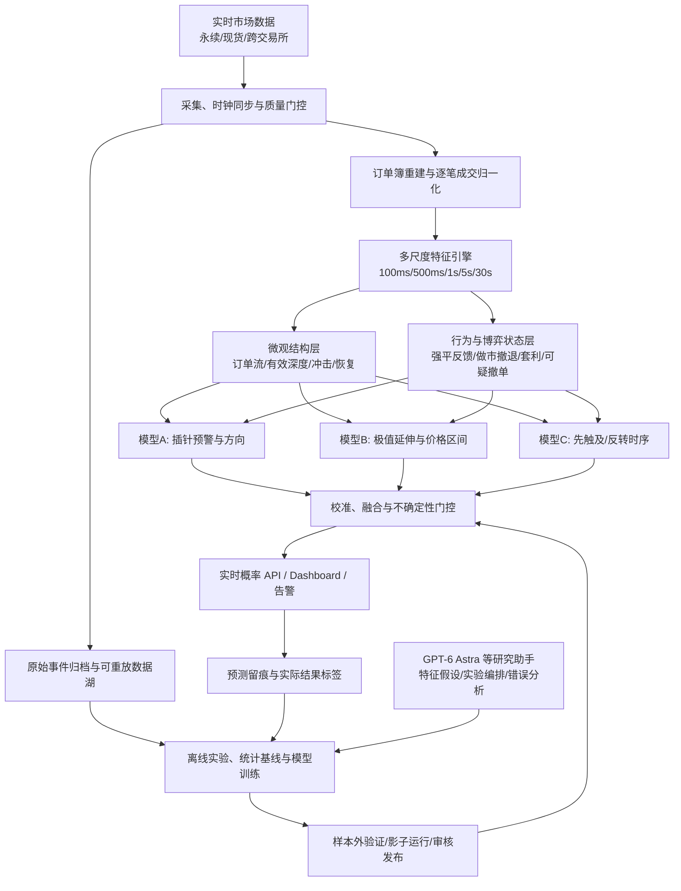

# 加密货币插针预警与极值预测系统——最终技术架构

> 版本：v1.0（架构设计稿）  
> 日期：2026-10-31  
> 定位：币安 USDT 永续合约及可对照现货/其他交易所的币种；以日常、局部、持续约 1–60 秒的上下插针为重点。  
> 核心目标：最大限度提升**真实样本外**的提前预警能力、方向概率校准、继续刷新极值预测与未来极值区间质量。**不承诺预先设定的胜率。**

## 1. 决策原则与目标

该系统不是“发现长影线”，而是在真实行情发生前和发生中连续回答四个问题：

1. **发生概率**：未来 5/10/30 秒内，是否会出现幅度达到阈值的局部价格异常？
2. **方向**：向上/向下插针各自的概率有多大？二者在同一时间窗口内可能同时发生。
3. **极值延伸**：当前插针的最高/最低价，未来 5/10/30 秒内会否被刷新？先延伸还是先回撤？
4. **极值分布**：未来一段时间的最高价、最低价可能落在什么区间？区间及其可信度是多少？

坚持三条原则：

- **预测与观测分离**：仅使用系统发出预测时已经实际收到的数据，不得把事后极值、未来成交或跨交易所晚到的数据用于当时的预测。
- **解释与准确性分离**：微观结构、心理与博弈推断可提出解释，但任何额外模型是否提高准确性必须由独立样本外实验裁决。
- **概率与交易收益分离**：即使方向预测准确，也不能直接等同于可成交、可盈利或可控制极端轧空风险。

## 2. 总体系统拓扑



**在线职责**：Go 处理采集、订单簿、特征、推理调用、预警与审计；本地 CPU 模型/数学计算完成毫秒级预测。  
**离线职责**：Python + LightGBM + Optuna 等完成训练、概率校准、模型对比。GPT 模型只辅助研究和软件工程，不置于每 100ms 的实时预测链路。

## 3. 行情必须覆盖的八个维度

| 层次 | 维度 | 关键特征 | 用途 |
|---|---|---|---|
| 价格 | 1. 价格路径 | 对数收益、速度、加速度、实现波动率、异常跳变 | 区分一般波动与插针 |
| 交易 | 2. 主动订单流 | 主动买/卖成交额、频率、OFI、订单流加速度与持续时间 | 识别推动力及方向 |
| 流动性 | 3. 有效盘口 | 距盘口 ±0.1/0.5/1% 深度、价差、撤单迹象、补单速度 | 判断冲击可到达多远 |
| 价格冲击 | 4. 冲击与恢复 | 单位成交价格冲击、盘口重建半衰期、同量冲击变化 | 判断压力持续还是衰竭 |
| 跨市场 | 5. 现货及其他交易所 | 合约–现货基差、跨所偏离、外部市场响应时差 | 辨别局部异常与共同重定价 |
| 杠杆 | 6. 衍生品结构 | OI、资金费率、基差、可观测强平事件 | 推断轧空/连锁平仓可能性 |
| 情境 | 7. 市场状态 | 近期波动分位、成交活跃度、流动性分位、市场同步性 | 使不同币种与状态可比较 |
| 可靠性 | 8. 数据可信度 | 消息丢序、接收延迟、时间戳误差、数据缺口、跨所滞后 | 阻止错误输入产生虚假高置信度 |

为避免低流动性币和主流币特征尺度差异，各类成交/深度/波动特征应做币种内、时间段内、滚动历史基线的标准化。滚动统计必须只使用时点之前的数据。

## 4. 交易、心理与博弈：三层互补建模

### 4.1 市场微观结构（观察已发生什么）

- **主动成交**：持续买入还是持续卖出、订单流是否加速。
- **盘口更新**：买卖档位增加/减少、价差扩大、深度抽离和重新填补。
- **冲击效率**：同样的净主动成交金额是否能推动越来越多的价格档位。
- **跨市场联动**：其他市场是否同步走动、出现暂时性局部偏离。

参考数学特征：

\[
I_{\mathrm{flow}}(t)=\frac{V_{\mathrm{buy}}(t)-V_{\mathrm{sell}}(t)}{V_{\mathrm{buy}}(t)+V_{\mathrm{sell}}(t)+\epsilon}
\]

\[
\lambda_{\mathrm{impact}}(t)\approx\frac{\Delta\log P_t}{Q_{\mathrm{net},t}}
\]

第二式用于说明概念，工程实现要用稳健滚动回归估计，而非净成交额接近零时直接相除。

### 4.2 参与者行为（推断可能为什么行动）

分析五类可能参与者，但**不得从公开订单簿断言具体账户、意图或违法操纵**：

1. **主动推动者**：吃单、拆单与高强度推进。
2. **高杠杆交易者**：止损、追加保证金、被动强平；公开强平数据不等于完整强平流。
3. **做市商**：根据库存、逆向选择和波动风险撤单、加价差或补单。
4. **套利交易者**：对局部跨市场价差做反向交易，但跨市场收敛不保证由本交易所反弹完成。
5. **追涨杀跌者**：突破跟随、踩踏、反身性反馈。

心理/行为不是读取参与者内心，而是把其可验证的行为后果（追价成交、撤退、流动性恢复、止损加速）映射为可观测变量。

### 4.3 动态博弈（预测下一步反应）

用**潜在状态推断**代替武断的“庄家正在拉盘/砸盘”标签。主要假设状态可以同时存在：

- H1：主动扫单主导；
- H2：强平/止损连锁反馈主导；
- H3：做市商因库存及风险撤退；
- H4：跨市场套利与补流动性开始介入；
- H5：可疑挂单和撤单使显示深度失真；
- H6：较普通的多平台共同价格重定价。

根据截至时点 \(t\) 的观测 \(O_{\le t}\) 更新潜在状态概率：

\[
P(H_i\mid O_{\le t})
\]

并用状态条件预测组合未来结果：

\[
P(Y\mid O_{\le t})=\sum_i P(Y\mid H_i,O_{\le t})P(H_i\mid O_{\le t})
\]

这个公式适用于**互斥的潜在情境划分**；如要保留 H1–H6 的重叠性，需改用多标签潜在因子或组合状态模型，而不能直接把不互斥事件的概率相加。第一版可使用多标签风险特征 + 监督分类；随后再研究隐马尔可夫/状态空间模型、Hawkes 过程和多主体仿真。

## 5. 虚假挂单与有效流动性防护

### 5.1 不直接相信显示深度

公开 L2 通常是**价格档聚合信息**，不是每张订单的真实生命周期。订单数量变化可能由成交、撤单、修改和推送合并等多种因素造成。

重点特征：

- 大额挂单出现到减少的时间、频度及价格距离；
- 价格接近时盘口撤退速度；
- 撤退后补单速度及成交兑现的估计值；
- 买卖盘深度与真实主动成交是否背离；
- 多档位同步出现/撤退、同类异常循环；
- 跨现货和交易所的支持或不支持证据。

### 5.2 有效深度是可训练的预测量

\[
D_{\mathrm{eff}}(t,h)=\sum_{i} q_i(t)\,p_i(t,h)
\]

- \(q_i(t)\)：当前第 i 档显示数量；
- \(p_i(t,h)\)：未来风险窗口 h 内该档深度在价格冲击到达时仍可提供流动性的估计权重。

这个量不是可保证成交量。若不存在逐订单生命周期数据，\(p_i\) 需要根据历史**盘口存续/衰减代理标签**估计；必须报告估计误差并进行预测校准。

### 5.3 对抗性鲁棒性

让模型在“巨额挂单突然消失”“单市场盘口异常、其他市场稳定”“虚假反向信号后轧空”等样本上单独评分。可疑 Spoofing 只标记为*异常盘口行为*，不可未经证据定性违法操纵。

## 6. 预测目标及形式化标签

### 6.1 模型 A：提前预警与方向概率

在预测时点 t、窗口 h∈{5,10,30} 秒定义（以当时可交易参考报价或中间价的对数价格为基础）：

\[
Y_{\uparrow}(t,h,a)=\mathbf{1}\left[\max_{t<s\le t+h}\log\frac{P_s}{P_t}\ge a\right]
\]

\[
Y_{\downarrow}(t,h,a)=\mathbf{1}\left[\min_{t<s\le t+h}\log\frac{P_s}{P_t}\le-a\right]
\]

其中 a 可设为绝对幅度阈值（例如对数 1%/2%/3%）或波动标准化阈值。两个事件可以在同一窗口同时成立，因此分别输出概率，不强制求和为 100%。

同时设置**事件触发器**区分日常插针和系统性大行情。例如，单币 5–30 秒的异常变动幅度、相对历史波动分位、跨市场不同步程度等；阈值需基于训练集制定。

### 6.2 模型 B：未来极值及继续刷新概率

- 在时点 t 记录当前插针截至 t 已经观察到的 \(H_t^{\mathrm{obs}}\) 和 \(L_t^{\mathrm{obs}}\)。
- 输出未来 h 秒内刷新已观察极值至少 δ 的概率：

\[
P\left(\max_{t<s\le t+h}P_s>H_t^{\mathrm{obs}}+\delta\mid O_{\le t}\right)
\]

以及对称的最低价刷新概率。

- 同时预测 \(\max_{t<s\le t+h}P_s\) / \(\min_{t<s\le t+h}P_s\) 的 Q10/Q50/Q90 等分位数。
- 用单调分位数后处理或合适算法防止 **Q10 > Q50 > Q90** 的分位数交叉；并用时间独立样本检验真实覆盖率。
- 不给出“精确拐点已确认”的虚假结论；在持续轧空或行情失控时允许区间扩大和信号弃权。

### 6.3 模型 C：先延伸还是先回撤（路径竞争）

以上插针为例：预测未来 h 秒内，价格先上涨 u%（延伸），还是先下跌 d%（回撤）。

\[
P(T_{\mathrm{extend}}<T_{\mathrm{retrace}},\;T_{\mathrm{extend}}\le h\mid O_{\le t})
\]

另设“截止 h 秒均未达到”类别；需要对两类阈值同窗极短时间内触及、数据采样不能确认先后的情况制定保守标注规则。可用多分类、离散时间危险率或竞争风险模型。

### 6.4 输出概率而非仅输出评分

每个概率需经过校准（例如 Platt/Isotonic，选法由验证集决定），并报告不确定性、样本支持度、行情质量。不能把盘口失衡评分简单映射成“80%”。

## 7. 模型组合与优先级

**优先部署的强基线**：

- 基线 S：历史条件频率 + 分层/贝叶斯平滑；
- 基线 L：逻辑回归，便于诊断解释；
- 主模型 G：LightGBM（预警分类、极值分位数、续创新高/低）；
- 状态层 R：状态识别/博弈代理特征；
- 候选深度模型 T：Temporal CNN / 时序 Transformer；
- 候选生成层 H：Hawkes / 跳跃过程与路径模拟。

**模型融合只有在样本外优于最佳单模型时才上线**。尽量先使用跨币种通用模型，输入币种流动性、波动率等状态特征，再检验是否需要对某些币做单独校准或专业模型。

GPT-6 Astra 等大模型的职责限定为**离线研究助手**：

- 自动提出可证伪的特征/博弈假设；
- 编写特征工程、模型训练、Optuna 搜索和回测程序；
- 解释误报和失败样本，发现数据泄漏、样本偏移；
- 生成和审查 Go/Python 工程代码。

在线推理就是本地数学运算（例如树比较、加法、概率映射），不需要逐次调用 GPT API。

## 8. 数据采集、时钟与回放

### 8.1 必需的实时数据

| 来源 | 优先级 | 采集内容 |
|---|---|---|
| Binance USDT-M 永续 | 必需 | L2 深度增量、最优买卖价、逐笔/聚合成交、参考价格 |
| Binance 现货 | 必需/强烈建议 | 同币现货盘口与成交，用作跨市场对照 |
| 其他交易所 | 强烈建议 | Bybit 等对应产品的盘口和成交，用于偏离及联动判断 |
| 衍生品辅助数据 | 辅助 | OI、基差、资金费率、公开强平数据，按真实粒度使用 |

对历史 L2 数据可选择**自建实时连续录制**或购买带时序深度更新的历史数据库；交易所提供的历史 K 线和成交文件**不能替代完整 L2 历史**。上线前应再次核对交易所当期 WebSocket 入口、订阅限制、订单簿同步协议与使用条款。

### 8.2 消息必须存的字段

- venue、symbol、channel、原始 payload；
- exchange_event_time、exchange_transaction_time（若存在）、local_receive_time；
- 连接会话 ID、序列号、是否断序/重连、同步状态；
- 数据提供者版本及规范化解析版本。

时钟需以 Chrony/NTP 校准；如采用低延迟时间同步设施则可升级。不同平台的事件时间戳精度和语义可能不同，统一以**系统实际可用时刻**限定特征可见性。

### 8.3 在线数据质量门控

订单簿更新断序、快照未同步、跨所数据严重滞后、机器时钟异常、特征积压时：

1. 标记相应数据为不可用；
2. 停止使用相关特征或直接**不输出高置信度预警**；
3. 自动重新同步并记录异常。

对于高频研究，**行情重放必须复现原始消息到达顺序及当时的数据可用性**，不能仅按交易所事件时间理想排序。

## 9. 生产实时程序

### 9.1 技术栈

- **Go**：交易所 WebSocket 采集、订单簿重建、实时特征、在线模型调用、状态机、预警 API；
- **Python**：DuckDB/Polars/Pandas、LightGBM、Optuna、离线数据清理与训练；
- **存储**：最近数日的本地 NVMe + Parquet/ZSTD 历史归档 + 对象存储；
- **前端**：React、时间序列/盘口图与 WebSocket 实时数据；
- **监控**：Prometheus/Grafana 或同等设施，记录延迟、缺包、同步状态、模型输出和预测准确性。

### 9.2 主流程

```text
实时市场消息进入
  -> 原始消息落盘/缓冲，记录 receive_time
  -> 数据质量检查和本地订单簿维护
  -> 更新 100ms/500ms/1s/5s/30s 特征缓存
  -> 判断 NORMAL / PRE_ALERT / SPIKE_UP / SPIKE_DOWN / RECOVERY / COOLDOWN
  -> 调用模型 A：未来 5/10/30 秒上、下插针概率
  -> 如果已处于插针：调用模型 B、C
  -> 概率校准、冲突检查、置信度/数据质量门控
  -> API 与告警输出
  -> 记录模型版本、特征快照、预测结果、精确发出时间
  -> 未来结果到达后异步生成标签、评估预测（不反馈到原预测）
```

**运行目标（非保证值）**：以 100–200ms 为特征与预测更新频率设计目标；从消息接收至输出预测的端到端 P99 目标初始设置为 <50ms，再根据实测调整。对迟到数据、拥堵和行情尖峰做专门压测。

### 9.3 参考预测 API 格式

```json
{
  "symbol": "EXAMPLEUSDT",
  "venue": "binance_um",
  "asof_receive_time": "2026-10-31T01:00:00.200Z",
  "model_version": "spike-v1.2",
  "data_quality": "healthy",
  "market_state": "spike_up",
  "horizon_sec": 10,
  "up_spike_probability": 0.21,
  "down_spike_probability": 0.07,
  "new_high_probability": 0.64,
  "future_high_quantiles": {"q10": 1.072, "q50": 1.083, "q90": 1.105},
  "extend_first_probability": 0.46,
  "retrace_first_probability": 0.32,
  "neither_within_horizon_probability": 0.22,
  "uncertainty_status": "normal"
}
```

> 上面全部数值都是接口示例，不是实际预测结果。`extend_first` / `retrace_first` / `neither` 应由同一多分类或竞争风险建模保证互斥且概率和为 1；未来高价量化分位数和刷新当前已观察最高点的概率须经过一致性检查。

## 10. 回测、模型选择与准确性评估

### 10.1 对照与切分

- 根据时间顺序划分训练、调参验证、最终封存测试集；
- 在同一事件周边进行时间隔离（purging/embargo），避免重叠标签泄漏；
- 对新币、低流动性币和独立月份单独评估；
- 禁止根据测试集成绩反复挑选阈值、模型或交易对；
- 通过真实消息延迟和当时可见数据开展事件驱动重放，而非事后重建理想盘口。

### 10.2 分任务评分

| 任务 | 主要指标 | 不能只看什么 |
|---|---|---|
| 预警 | 每小时误报数（FAR）、固定误报预算下召回率、提前时间 P50/P90、PR-AUC | 总体准确率（多数时间无事件） |
| 方向 | 真正发生插针样本中的方向命中率、精确率与基准概率提升 | 只挑暴跌样本的事后胜率 |
| 概率 | Brier 分数、Log Loss、可靠性曲线/ECE、分行情校准 | 模型原始输出的百分比 |
| 极值区间 | Pinball Loss、实际区间覆盖率、区间平均宽度、条件覆盖率 | 只看 Q50 与极值绝对误差 |
| 极值延伸 | 续创新高/低的精确率、召回率、校准、不同窗口稳定性 | 插针最终“总会回落”的事实 |
| 先触及 | 三分类 Brier/Log Loss、先触及命中率、无法分辨触及顺序比例 | 单一终点涨跌 |

### 10.3 博弈层是否真的有价值

做强制消融实验：

1. 仅价格、成交、基础盘口；
2. 加入有效深度与撤单风险；
3. 加入跨所联动；
4. 加入杠杆/强平代理；
5. 加入潜在博弈状态与反馈特征；
6. 可选加入 TCN/Hawkes/融合。

只有在**独立测试样本中**对同一误报约束、同一延迟预算、同一币种集合产生稳定增益时才保留新增层次。高复杂度或解释性不代表准确率提高。

### 10.4 影子运行与安全约束

先运行只预测、不交易的影子系统。保存每一次实时预报、之后实际价格路径、数据健康状况；连续检查误报与模型漂移。必要时触发弃权/降置信度。系统不应将预测值当作可保证盈利的交易建议。

## 11. 服务器与部署位置

### 11.1 初始规模建议

| 监控规模 | 在线 CPU | 内存 | 本地 NVMe | 说明 |
|---|---|---|---|---|
| 10–20 币 | 4 vCPU | 8–16GB | 200GB | 原型阶段 |
| 30–50 币 | **8 vCPU** | **32GB** | **500GB** | 推荐起步；优先独享高主频 CPU |
| 100–200 币 | 16–32 vCPU | 64GB | 1–2TB | 拆分采集/特征/预测服务 |

CPU 本地推理即可；**线上不必配 GPU**。训练可以另租 16 核、64GB 内存的按需机器；神经网络规模扩大再评估 GPU。存储负担取决于 L2 消息速率和保留期，应先录制代表性行情再估算，不能从币种数量简单推断。

### 11.2 部署区域

- 东京、新加坡、香港列为候选，而不是假定某地必然最接近交易所撮合引擎。
- 在候选区域部署相同采集程序，连续测 **24–72 小时** 的消息到达新鲜度、P50/P99、抖动、断流、快照恢复和高波动期间表现。
- 选择**整体行情延迟与可靠性最佳**、合规可访问交易所 API 的区域；模型训练服务器不一定与在线采集同区。
- 关键生产环境增加备用接入或备用节点并防止双活消息重复计数。

## 12. 开发阶段与交付标准

| 阶段 | 工作 | 验收条件 |
|---|---|---|
| P0 数据底座 | WebSocket、订单簿、时钟、日志、历史重放 | 长时连续运行，能核对序列与数据缺口 |
| P1 事件库 | 插针标签、不同币种基线、普通趋势反例 | 标签可复现，无未来信息泄漏 |
| P2 数学/ML 基线 | 条件概率、逻辑回归、LightGBM | 有封存测试集、可靠性曲线、误报预算 |
| P3 极值模型 | 分位数、刷新极值概率、先触及模型 | 区间覆盖率及竞争事件概率可检验 |
| P4 对抗性/博弈层 | 有效深度、撤单风险、潜在状态 | 通过消融实证证明是否增益 |
| P5 线上影子运行 | 预警、Dashboard、告警与失败分析 | 真实实时预测与回测一致，满足延迟预算 |
| P6 迭代升级 | TCN/Hawkes/融合、新币泛化 | 只发布独立测试与影子运行改善的模型 |

## 13. 最终交付物

1. **市场数据平台**：完整原始事件归档、在线订单簿、可重复回放。
2. **多维行情表征**：价格、订单流、流动性、冲击、跨市场、杠杆、市场状态与数据质量。
3. **行为与博弈状态引擎**：可疑撤单、强平反馈、做市撤退、套利恢复等可观测代理变量。
4. **预测引擎**：5/10/30 秒上下插针概率、续刷新极值概率、极值价格分位数、先延伸/先回撤概率。
5. **研究实验平台**：统计基线、LightGBM、时序模型候选、Optuna、自动消融与封存测试。
6. **实时前端与告警**：数据可信度、实时概率、可视化、误报/命中记录。
7. **上线治理机制**：模型版本、预测审计、延迟监控、数据断线门控、回退与影子测试。

## 14. 核心结论

**准确的插针预测需要同时刻画“已经发生的订单流与价格冲击”“参与者可能采取的下一步博弈反应”“可用流动性是否真实且持续存在”，再将这些信息映射为经样本外校准的条件概率和极值区间。**

不是简单追求多模型，而是建立可检验的完整闭环：

**真实事件采集 → 多尺度状态表征 → 微观结构与博弈特征 → 预测模型 → 概率校准 → 真实时间回放与在线留痕 → 独立验证 → 选择性上线。**

只有真实数据能回答最高能达到多少准确率；任何事先承诺的 80% 或 90% 都没有依据。
